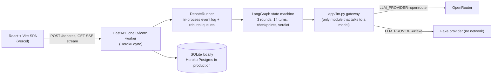

# Startup War Room

A multi-agent debate that stress-tests a startup idea. Adversarial AI personas (VC, customer, CTO, competitor) argue over your pitch in rounds, you can interject with a rebuttal, and a judge returns a schema-validated verdict: recommendation, scorecard, ranked risks, and experiments with kill criteria.

AI critique for brainstorming, not professional advice. Do not paste confidential or proprietary information.

## Architecture



## Setup

Requirements: Python 3.12 (managed by `uv`), Node 22.

```bash
cp .env.example .env            # then edit; .env is git-ignored
cd backend && uv sync
uv run uvicorn app.main:app --reload --port 8000
# in another terminal
cd frontend && npm ci && npm run dev    # http://localhost:5173, proxies /debates to :8000
```

### Fake-provider quickstart (no key, no cost, no network)

```bash
cd backend
LLM_PROVIDER=fake uv run uvicorn app.main:app --port 8000
curl localhost:8000/health      # {"status":"ok"}
cd ../frontend && npm ci && npm run dev
```

The fake provider returns canned debate turns and a valid verdict, so the whole flow runs end to end. Tests always use it:

```bash
cd backend && uv run pytest -q
cd frontend && npx vitest run && npm run build
```

## Environment variables

| Variable | Default | Purpose |
|---|---|---|
| `LLM_PROVIDER` | `openrouter` | `openrouter` or `fake` |
| `OPENROUTER_API_KEY` | empty | Required when the provider is `openrouter`. Environment only |
| `OPENROUTER_BASE_URL` | `https://openrouter.ai/api/v1` | API base |
| `FAST_MODEL` | `openai/gpt-6.1-terra` | Guards, persona, critics, checkpoints |
| `AGENT_MODEL` | `openai/gpt-6.1-terra` | Critic turns |
| `JUDGE_MODEL` | `openai/gpt-6.1-sol` | Verdict |
| `ESCALATION_MODEL` | `anthropic/claude-opus-5.5` | Verdict retry after two failed validations |
| `FAKE_DELAY_S` | `0` | Per-token delay for the fake provider |
| `DATABASE_URL` | `sqlite+aiosqlite:///./warroom.db` | Heroku's `postgres://` is converted to `postgresql+asyncpg://` with TLS |
| `FRONTEND_ORIGIN` | `http://localhost:5173` | The one allowed CORS origin |
| `TRUSTED_PROXY_HOPS` | `0` | Proxies whose `X-Forwarded-For` entry is trusted for rate limiting. Set `1` on Heroku |
| `MAX_TURNS` | `14` | Turn cap |
| `MAX_TOKENS_PER_DEBATE` | `120000` | Hard token cap per debate. No LLM call starts once it is reached |
| `JUDGE_TOKEN_RESERVE` | `60000` | Turns and checkpoints stop this far below the cap, leaving the rest for the verdict ladder. Must be below the cap, or the app refuses to start |
| `RATE_LIMIT_PER_HOUR` | `5` | Debates per client per hour |
| `INTAKE_RATE_LIMIT_PER_HOUR` | `20` | Intake checks per client per hour |
| `REBUTTAL_TIMEOUT_S` | `45` | Wait for a founder rebuttal |
| `DEBATE_TIMEOUT_S` | `240` | Whole-debate timeout |
| `MAX_CONCURRENT_DEBATES` | `10` | Concurrent debates |
| `VITE_API_URL` | empty | Frontend build-time: backend base URL (set in Vercel) |

### Changing models

Model IDs live only in environment variables. To swap one, set it and restart; no code change:

```bash
heroku config:set JUDGE_MODEL=<openrouter-model-id> --app <app>
```

Cost is read from OpenRouter's usage accounting, so a new model needs no price table.

## Health check

`GET /health` returns `{"status":"ok"}`. It checks that the process is up, not the database or the model provider.

## Deployment

- Backend: Heroku Basic dyno plus Heroku Postgres. Deploy the `backend/` directory with `git subtree push --prefix backend heroku main`, so `backend/Procfile`, `pyproject.toml`, `uv.lock` and `.python-version` sit at the build root, which is what Heroku's Python buildpack uses to detect a uv project. `backend/Dockerfile` runs the same command for any container host.
- Frontend: Vercel with root directory `frontend`, env `VITE_API_URL` set to the backend URL. `frontend/vercel.json` rewrites all paths to `index.html` for the SPA router.
- Set `FRONTEND_ORIGIN` on the backend to the Vercel URL (no trailing slash).

## Known limits

- One web process only. The event log and rebuttal queues are in process memory, so scaling to more than one dyno or worker breaks live streams.
- In-flight debates are lost on restart or dyno cycling. On startup, debates left `running` are marked `failed`.
- Rate-limit state lives per process and resets when the dyno restarts.
- No live market data. Critique reasons from the pitch and the model's knowledge, which may be out of date or wrong.
- Critique is for brainstorming and is not professional advice.
- No authentication. Debates are public to anyone with the unguessable link; deletion uses a token shown once at creation.
- The Postgres path has not been exercised against a live Postgres in this repository's tests, which run on SQLite.

## Measured results

> Not yet measured. To be filled after the eval run: completion rate, p50 latency, cost per debate. No number appears here until it has been measured.

| Metric | Value | Pitches | Date |
|---|---|---|---|
| Completion rate | _pending_ | | |
| p50 latency | _pending_ | | |
| Cost per debate | _pending_ | | |
