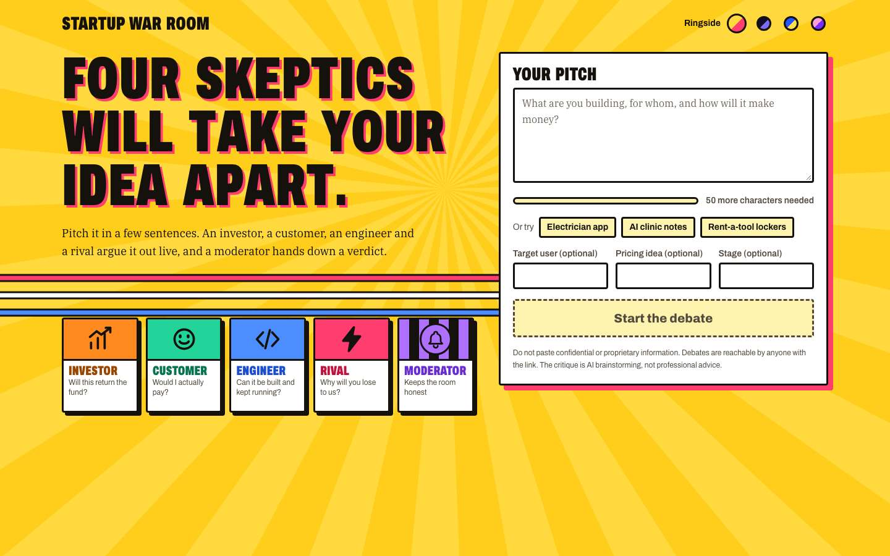
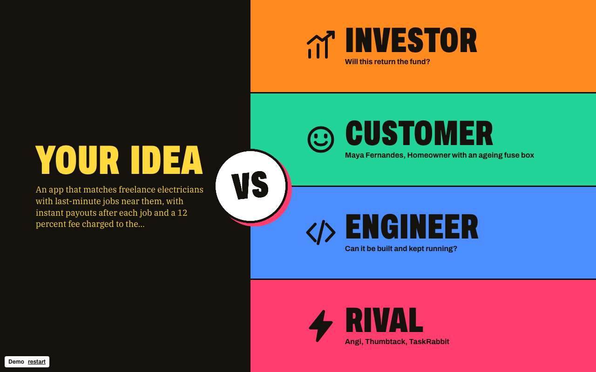
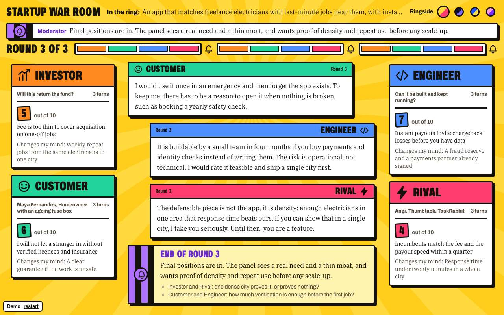
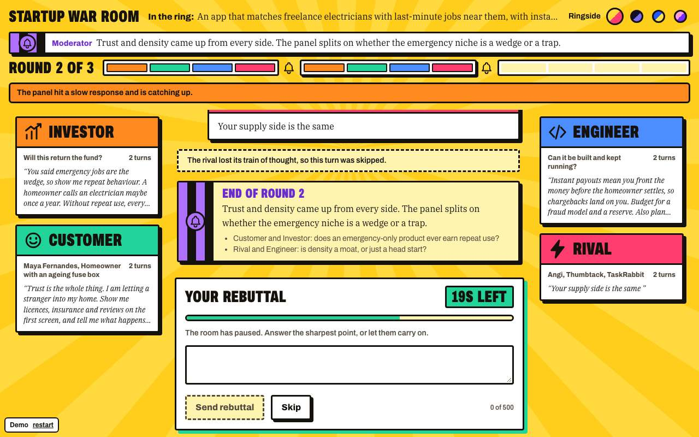
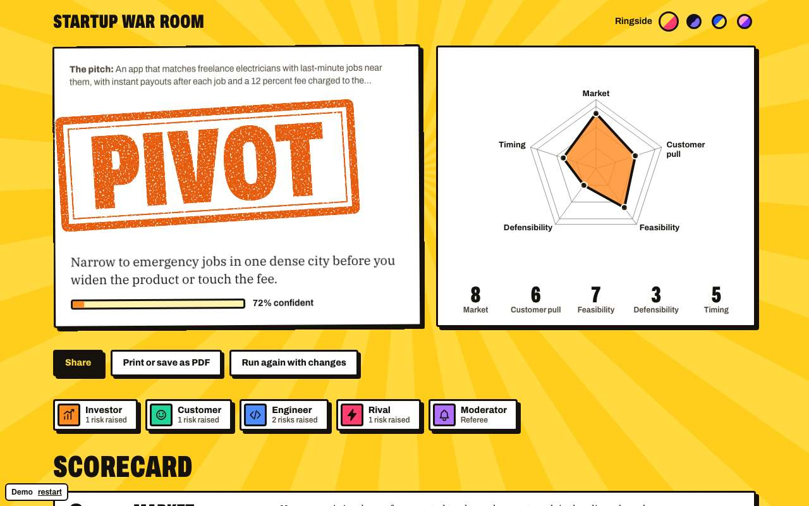
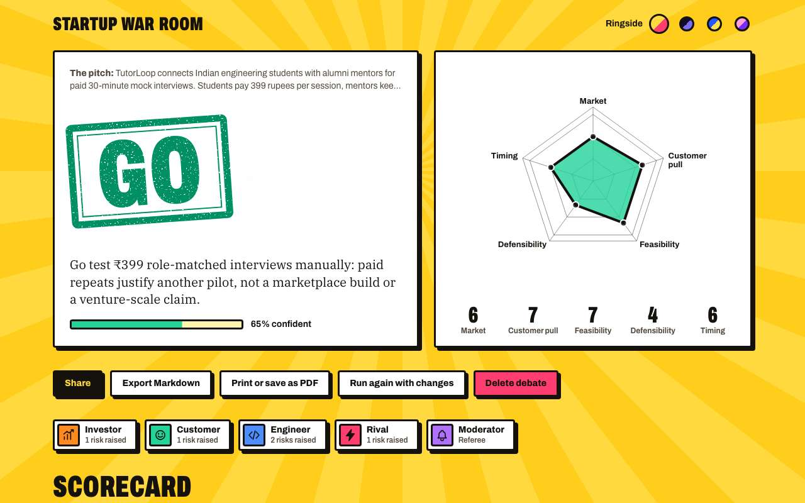
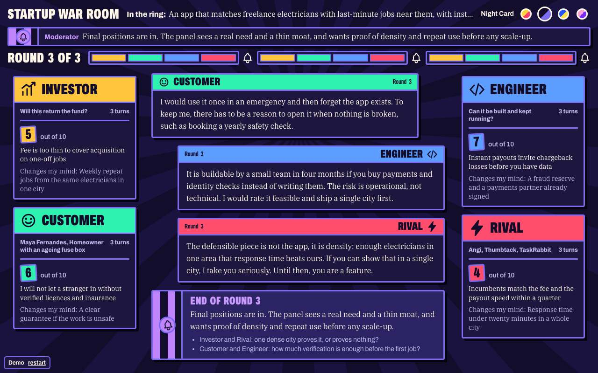
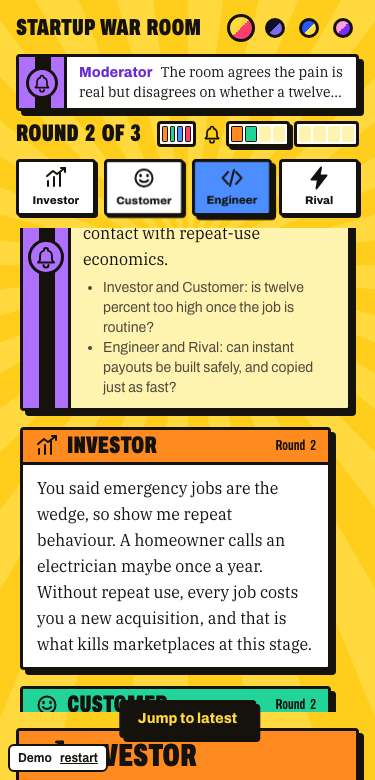
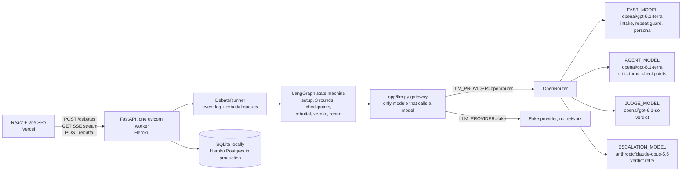

# Startup War Room

**Four adversarial AI agents tear into your startup pitch live. A moderator rules GO, PIVOT or NO-GO, and you get one rebuttal.**

[](https://github.com/satyam237/startup-war-room/actions/workflows/ci.yml)

**Live: https://startup-war-room.vercel.app**



## What it is

Ask a chatbot about your startup idea and it usually says it is a great idea. That feedback is pleasant and close to useless. Startup War Room points the model the other way. Four personas with conflicting incentives argue over your pitch while you watch, and the result is a schema-validated verdict with a scorecard, ranked risks, and three experiments you can run.

| Agent | Asks |
|---|---|
| Investor | Will this return the fund? |
| Customer | Would I actually pay? (a persona built from your pitch) |
| Engineer | Can it be built and kept running? |
| Rival | Why will you lose to us? |
| Moderator | Keeps the room honest, summarizes each round, rules on the verdict |

AI critique for brainstorming, not professional advice. Do not paste confidential or proprietary information.

## How a debate works

1. **Setup.** The pitch (50 to 2000 characters, plus optional target user, pricing and stage) passes an intake check. The app then builds a customer persona and names likely competitors.
2. **Three rounds.** Round 1 is the opening critique, round 2 is cross-examination, round 3 is final positions: each agent gives a 1 to 10 score, its top risk, and what would change its mind. A repeat guard regenerates a turn that only restates an earlier one.
3. **Moderator checkpoints** summarize the room after rounds 1 and 2.
4. **One rebuttal.** After the round 1 checkpoint the room pauses for up to 45 seconds. You can answer the sharpest point (500 characters at most) or skip.
5. **Verdict.** The moderator returns GO, PIVOT or NO-GO with a confidence figure, a five-dimension scorecard (market, customer pull, feasibility, defensibility, timing), ranked risks tagged by the agent that raised them, and three experiments.
6. **Experiments.** Each has a time box, a success criterion that says when to keep going, and a kill criterion that says when to stop.

The result page is shareable by link, exports to Markdown, and prints to PDF.

## Features

| | |
|---|---|
| <br>**Versus intro.** Your idea against the four agents, with the customer persona and rivals named from your pitch. | <br>**Live debate room.** Turns stream in over SSE. Each card shows the agent's score and its "changes my mind" condition. |
| <br>**Founder rebuttal.** The room pauses on a countdown. Send a reply or skip. | <br>**Verdict with a stamp.** Recommendation, confidence and a radar scorecard. |
| <br>**A real GO verdict from production.** GO is rare. This run returned it in 144 seconds. | <br>**Four themes.** Ringside, Night Card, Courtside and Bubblegum. |

On a phone the room shows one agent tab at a time:

<p align="center"></p>

Screenshots 02 to 05, 07 and 08 come from the scripted dev demo (`/?demo=1`), which is why a "Demo" badge sits in the corner. Screenshot 06 is a live production run.

## Architecture



- **Frontend:** React and Vite single-page app in `frontend/`, deployed on Vercel. A reducer folds the SSE event stream into room state.
- **Backend:** FastAPI in `backend/app/`, with the debate as a LangGraph graph. Debates, turns and verdicts are stored in Postgres (SQLite in dev).
- **Model routing:** model IDs are environment variables only. See [Changing models](#changing-models).

### Safety

- **Untrusted input.** The pitch, its metadata and earlier turns are wrapped in delimiter tags, and prompts tell the model to treat that content as data. Markdown export quotes untrusted text so it cannot add headings or lists.
- **Rate limits.** Per-client limits on debates and on intake checks, keyed on the client IP with a configurable trusted-proxy count.
- **Budgets.** A hard token cap per debate, a reserve held back for the verdict, a turn cap, a whole-debate timeout, and a cap on concurrent debates. No model call starts once the token cap is reached.
- **Verdict validation.** The verdict is checked against a schema and for internal consistency. The ladder is judge, judge retry with the errors appended, escalation-model repair, then a fallback verdict that is flagged as one.

## Quick start

Requirements: Python 3.12 (managed by `uv`) and Node 22.

```bash
cp .env.example .env            # then edit; .env is git-ignored
cd backend && uv sync
uv run uvicorn app.main:app --reload --port 8000
# in another terminal
cd frontend && npm ci && npm run dev    # http://localhost:5173, proxies /debates to :8000
```

### Fake-provider mode (no key, no cost, no network)

```bash
cd backend
LLM_PROVIDER=fake uv run uvicorn app.main:app --port 8000
curl localhost:8000/health      # {"status":"ok","models_ok":true,"key_ok":true}
cd ../frontend && npm ci && npm run dev
```

The fake provider returns canned debate turns and a valid verdict, so the whole flow runs end to end. Tests always use it.

### Scripted demo (dev only)

With the frontend dev server running, open `http://localhost:5173/?demo=1` for a scripted debate in the browser. The demo module is not bundled in production builds.

## Environment variables

| Variable | Default | Purpose |
|---|---|---|
| `LLM_PROVIDER` | `openrouter` | `openrouter` or `fake` |
| `OPENROUTER_API_KEY` | empty | Required when the provider is `openrouter`. Environment only |
| `OPENROUTER_BASE_URL` | `https://openrouter.ai/api/v1` | API base |
| `FAST_MODEL` | `openai/gpt-6.1-terra` | Intake and repeat guards, persona |
| `AGENT_MODEL` | `openai/gpt-6.1-terra` | Critic turns, final positions, checkpoints |
| `JUDGE_MODEL` | `openai/gpt-6.1-sol` | Verdict |
| `ESCALATION_MODEL` | `anthropic/claude-opus-5.5` | Verdict retry after two failed validations |
| `FAKE_DELAY_S` | `0` | Per-token delay for the fake provider |
| `DATABASE_URL` | `sqlite+aiosqlite:///./warroom.db` | Heroku's `postgres://` is converted to `postgresql+asyncpg://` with TLS |
| `FRONTEND_ORIGIN` | `http://localhost:5173` | The one allowed CORS origin |
| `TRUSTED_PROXY_HOPS` | `0` | Proxies whose `X-Forwarded-For` entry is trusted for rate limiting. Set `1` on Heroku |
| `MAX_TURNS` | `14` | Turn cap |
| `MAX_TOKENS_PER_DEBATE` | `120000` | Hard token cap per debate. No LLM call starts once it is reached |
| `JUDGE_TOKEN_RESERVE` | `60000` | Turns and checkpoints stop this far below the cap, leaving the rest for the verdict ladder. Must be below the cap, or the app refuses to start |
| `RATE_LIMIT_PER_HOUR` | `5` | Debates per client per hour |
| `INTAKE_RATE_LIMIT_PER_HOUR` | `20` | Intake checks per client per hour |
| `REBUTTAL_TIMEOUT_S` | `45` | Wait for a founder rebuttal |
| `DEBATE_TIMEOUT_S` | `240` | Whole-debate timeout |
| `MAX_CONCURRENT_DEBATES` | `10` | Concurrent debates |
| `VITE_API_URL` | empty | Frontend build-time: backend base URL (set in Vercel) |

### Changing models

Model IDs live only in environment variables. To swap one, set it and restart; no code change:

```bash
heroku config:set JUDGE_MODEL=<openrouter-model-id> --app <app>
```

Cost is read from OpenRouter's usage accounting, so a new model needs no price table.

A swapped-in model must accept this app's requests. On OpenRouter's `/models` list, its `supported_parameters` must include `reasoning` and either `structured_outputs` or `response_format`, because every model here is sent both. The check runs at startup on the `openrouter` provider: an unsupported or unlisted model logs an ERROR and makes `/health` return `models_ok: false`. If the list cannot be fetched, the app logs a warning and starts anyway. After a swap, restart and read `/health`.

### Health check

`GET /health` always returns HTTP 200 while the process is up, with `{"status":"ok","models_ok":true,"key_ok":true}`. `models_ok` is `false` when the startup check found an unusable model, and `key_ok` is `false` when the `openrouter` provider has no `OPENROUTER_API_KEY`. It does not check the database, credits, or whether the provider is reachable now.

### Debate status

| Status | Meaning |
|---|---|
| `complete` | All rounds ran. A `fallback` verdict can still appear if the judge ladder failed |
| `budget_exceeded` | A token, turn, or time limit ended the debate early |
| `partial` | The debate ended short of four final positions, or the provider refused the key or the account (HTTP 401, 402, 403) after at least one critic spoke. The evals do not count it as completed |
| `failed` | No verdict: the provider refused before any critic spoke, or the process stopped |

## Tests

```bash
cd backend && uv run pytest -q                  # backend tests, fake provider
cd frontend && npx vitest run && npm run build  # component tests, then typecheck and build
cd frontend && npx playwright test              # end to end; starts its own backend and web servers
```

CI (`.github/workflows/ci.yml`) runs pytest, vitest and the build with `LLM_PROVIDER=fake`. Playwright is not part of CI. If its browsers are missing, run `npx playwright install` first.

### Eval harness

`backend/evals/run_evals.py` runs the 20 pitches in `backend/evals/pitches.json` through the debate graph, skipping the rebuttal.

```bash
cd backend
LLM_PROVIDER=fake uv run python evals/run_evals.py                   # free
uv run python evals/run_evals.py --yes-spend-money --max-spend 5.0   # real models
```

With any provider but `fake` it refuses to run without `--yes-spend-money`. `--max-spend` (default 5.0 USD) stops the run once that much is spent. It also stops early if every debate so far failed the same way, such as an out-of-credits 402. `--limit N` runs the first N pitches and `--concurrency N` (default 3) sets parallelism.

## Deployment

- Backend: Heroku Basic dyno plus Heroku Postgres. Deploy the `backend/` directory with `git subtree push --prefix backend heroku main`, so `backend/Procfile`, `pyproject.toml`, `uv.lock` and `.python-version` sit at the build root, which is what Heroku's Python buildpack uses to detect a uv project. `backend/Dockerfile` runs the same command for any container host.
- Frontend: Vercel with root directory `frontend`, env `VITE_API_URL` set to the backend URL. `frontend/vercel.json` rewrites all paths to `index.html` for the SPA router.
- Set `FRONTEND_ORIGIN` on the backend to the Vercel URL.
- Set `TRUSTED_PROXY_HOPS=1` on the backend (`heroku config:set TRUSTED_PROXY_HOPS=1 --app <app>`). Heroku's router is the one trusted proxy; left at `0`, every visitor shares one rate-limit bucket.

## Measured results

Measured on 2026-11-07 over the 20 pitches in `backend/evals/pitches.json`, run directly through the graph with three debates at a time, using `openai/gpt-6.1-terra` and `openai/gpt-6.1-sol`. Latency is inflated by that concurrency.

| Metric | Value |
|---|---|
| Completion rate | 100% (20 of 20) |
| Schema-valid verdicts | 100%, no fallbacks |
| p50 / p95 latency | 128.5s / 147.4s |
| Mean cost per debate | $0.085 |
| Turns regenerated for repetition | 0% |
| Debates with a turn over 120 words | 3 of 20 |

| Pitch type | Mean score | Verdicts |
|---|---|---|
| Strong | 4.8 | 5 pivot |
| Weak | 4.1 | 3 pivot, 2 no-go |
| Vague | 3.0 | 2 pivot, 3 no-go |
| Injection attempts | 4.4 | 5 pivot |

One production browser run took 132s from pitch to verdict. Its first turn appeared after about 15s, slower than the 3-second target, because input checks and the persona run first. A separate production run returned a GO verdict in 144s.

**Known limit:** no pitch in this set reached `go`, so the panel leans strict. Human usefulness ratings have not been collected.

## Known limits

- One web process only. The event log and rebuttal queues are in process memory, so scaling to more than one dyno or worker breaks live streams.
- In-flight debates are lost on restart or dyno cycling. On startup, debates left `running` are marked `failed`.
- Rate-limit state lives per process and resets when the dyno restarts.
- No live market data. Critique reasons from the pitch and the model's knowledge, which may be out of date or wrong.
- The panel is strict, so GO is rare.
- Critique is for brainstorming and is not professional advice.
- No authentication. Debates are public to anyone with the unguessable link; deletion uses a token that the browser that created the debate keeps in `localStorage`, so only that browser can delete it.
- The Postgres path has not been exercised against a live Postgres in this repository's tests, which run on SQLite.

## Roadmap

- Voice "Fight Night Broadcast" (in progress)
- Agent lineup selector
- Intensity slider
- Web search with citations
- History and auth

## License

No license has been chosen yet.
